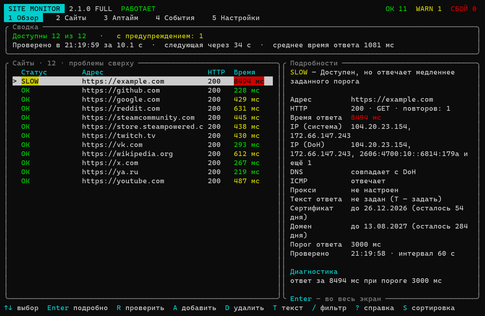
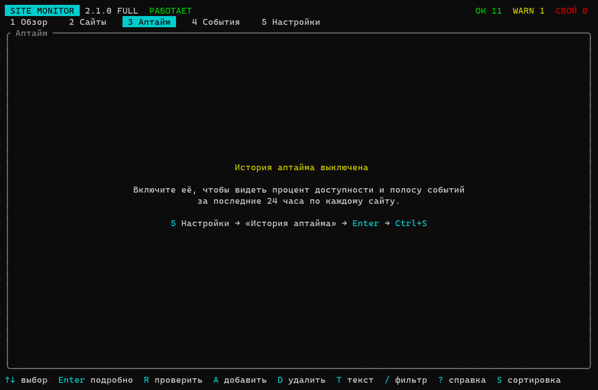
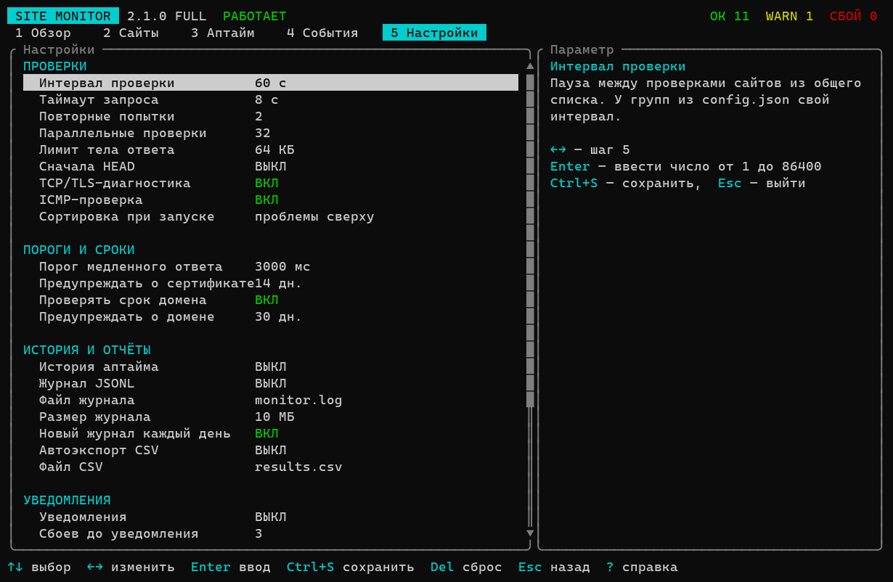

# WebsiteAccessibilityMonitor (WAM)

[](.github/workflows/rust.yml)
[](README.md)
[](Cargo.toml)
[](Cargo.toml)
[](LICENSE)

Console uptime monitor for HTTP/HTTPS resources: checks DNS, HTTP, the real TCP port, TLS and block-page stubs, and compares the direct path with a proxy route to tell outages from likely blocking.

**Руководство / User guide:** [Русский](docs/USER_GUIDE_RU.md) · [English](docs/USER_GUIDE_EN.md)







## Русский

### Что это

WAM — консольный монитор доступности HTTP/HTTPS-ресурсов. Он проверяет DNS, HTTP, фактический TCP-порт URL, TLS для HTTPS, известные страницы-заглушки и, при явной настройке, сравнивает прямой путь с HTTP/SOCKS-прокси.

- Статус: активный. Версия 2.1.0 — порт на Rust (ранняя версия была на .NET и удалена из репозитория).
- Стек: Rust 2024 (MSRV 1.88), tokio, reqwest, ratatui/crossterm; на Windows — `windows-service`, `winping`.
- Требования: Rust 1.88+ (`rustup`), для сборки на Linux — OpenSSL dev-пакет (TLS через `native-tls`).

### Сборка и запуск

```powershell
cargo build --release --bins
```

Основной интерфейс:

```powershell
.\target\release\SiteMonitor.exe
```

Упрощённый интерфейс:

```powershell
.\target\release\SiteMonitorLite.exe
```

Параметр `--config PATH` задаёт другой файл настроек, `--help` выводит справку.

### Интерфейс

Пять разделов, переключаются цифрами `1`–`5` или `Tab`:

| Раздел | Что показывает |
|---|---|
| Обзор | Сводка (сколько сайтов недоступно, когда следующая проверка), список с проблемами сверху и подробности выбранного сайта |
| Сайты | Полная таблица: статус, код HTTP, время ответа, IP, повторы, группа |
| Аптайм | Процент доступности за 24 часа и полоса последних замеров (`█` — доступен, `▁` — сбой) |
| События | Сбои и восстановления, итоги циклов, ошибки записи файлов и отправки уведомлений |
| Настройки | Все параметры `monitor_settings`, журналов, CSV, уведомлений и прокси |

Основные клавиши: `R` — проверить сейчас, `P` — пауза, `A` — добавить сайт, `D` — удалить (с подтверждением), `T` — текст, который должен быть в ответе сайта, `Enter` — подробности, `/` — фильтр, `S` — сортировка, `E` — экспорт CSV, `Ctrl+S` — сохранить настройки, `Ctrl+R` — перечитать `config.json`, `?` — полная справка, `Q` — выход. Горячие клавиши работают и в русской раскладке, длинные токены и адреса можно вставлять из буфера обмена.

`SiteMonitorLite` — те же возможности в компактной компоновке (без сводной панели и боковых подробностей) и с более редкой перерисовкой; удобен для узких окон и SSH/RDP. Минимальный размер окна — 50 × 14.

Статус всегда подписан текстом, цвет лишь дублирует его. Цвета задаются в `color_theme` (`Green`, `DarkCyan`, `LightRed`, `#1e90ff` и т. п.); переменная окружения `NO_COLOR` отключает цвета полностью. Если `config.json` повреждён, программа работает с настройками по умолчанию и отказывается сохранять изменения, пока файл не исправлен.

Фоновый режим, служба Windows, метрики Prometheus, формат настроек и все статусы описаны в [руководстве](docs/USER_GUIDE_RU.md).

## English

### What It Is

WAM is a console uptime monitor for HTTP/HTTPS resources. It checks DNS, HTTP, the actual TCP port of the URL, TLS for HTTPS and known block-page stubs; when `proxy_url` is set it compares the direct path with an HTTP/SOCKS proxy route.

- Status: active. Version 2.1.0, a Rust port (the earlier .NET version has been removed).
- Stack: Rust 2024 (MSRV 1.88), tokio, reqwest, ratatui/crossterm; on Windows `windows-service` and `winping`.
- Requirements: Rust 1.88+ (`rustup`); on Linux an OpenSSL development package (TLS uses `native-tls`).

### Building and Running

```powershell
cargo build --release --bins
```

Main interface:

```powershell
.\target\release\SiteMonitor.exe
```

Compact interface:

```powershell
.\target\release\SiteMonitorLite.exe
```

`--config PATH` points to another settings file, `--help` prints the reference.

### Interface

Five sections, switched with `1`-`5` or `Tab`:

| Section | What it shows |
|---|---|
| Overview | Summary (how many sites are down, when the next check runs), a list with problems on top and details of the selected site |
| Sites | Full table: status, HTTP code, response time, IP, retries, group |
| Uptime | Availability over 24 hours and a strip of recent measurements (`█` up, `▁` failed) |
| Events | Failures and recoveries, cycle summaries, file write and notification errors |
| Settings | All `monitor_settings`, log, CSV, notification and proxy parameters |

Main keys: `R` check now, `P` pause, `A` add a site, `D` delete (with confirmation), `T` text that must appear in the response, `Enter` details, `/` filter, `S` sort, `E` export CSV, `Ctrl+S` save settings, `Ctrl+R` reload `config.json`, `?` full help, `Q` quit. Hotkeys also work in the Russian layout, and long tokens and addresses can be pasted from the clipboard.

`SiteMonitorLite` has the same features in a compact layout (no summary panel or side details) with less frequent redraws; it suits narrow windows and SSH/RDP. Minimum window size is 50 × 14.

A status is always labelled with text; colour only repeats it. Colours are set in `color_theme` (`Green`, `DarkCyan`, `LightRed`, `#1e90ff` and so on); the `NO_COLOR` environment variable turns them off. If `config.json` is damaged, the app runs on defaults and refuses to save until the file is fixed.

Background mode, Windows service, Prometheus metrics, the config format and all statuses are covered in the [guide](docs/USER_GUIDE_EN.md).

## Лицензия / License

MIT, см. / see [LICENSE](LICENSE).
