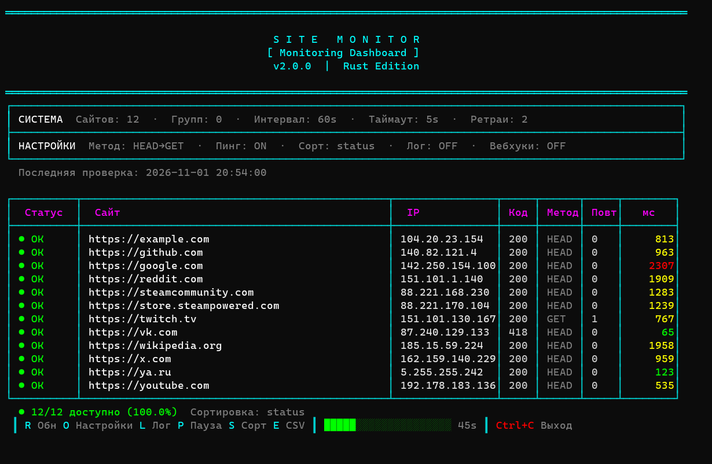

# WebsiteAccessibilityMonitor

[](README.md)
[](README.md)
[](CHANGELOG.md)
[](LICENSE)

Console monitor that checks websites over HTTP and ICMP, tracks daily uptime and sends alerts to Telegram, Discord and Slack.

**Руководство / User guide:** [Русский](docs/USER_GUIDE_RU.md) · [English](docs/USER_GUIDE_EN.md)




## Русский

### Что это

WebsiteAccessibilityMonitor (WAM) проверяет список сайтов через HTTP-запросы и ICMP-пинг и показывает результат таблицей в консоли. Подходит для контроля доступности сети и проверки региональных блокировок. Права администратора для пинга в Windows не нужны.

Есть две программы: полная `SiteMonitor` и упрощённая `SiteMonitorLite`.

### Возможности

- проверка сайтов HTTP-запросами: сначала HEAD, при неудаче GET, с настраиваемыми повторами;
- ICMP-пинг без прав администратора (только в Windows);
- определение IP сайта через DNS, в том числе через DNS-over-HTTPS;
- настраиваемые интервал, таймаут и списки допустимых кодов ответа;
- группы сайтов со своим интервалом и заголовками запросов;
- сортировка таблицы по статусу, адресу или времени ответа, прокрутка длинного списка стрелками;
- статистика аптайма за сутки с таймлайном в консоли;
- уведомления о падении и восстановлении в Telegram, Discord и Slack;
- работа через прокси, в том числе с логином и паролем;
- окно настроек прямо в программе;
- журналы в JSON с ротацией и экспорт в CSV.

### Установка

Нужен [Rust](https://www.rust-lang.org/tools/install).

```bash
git clone https://github.com/ServChan/WebsiteAccessibilityMonitor.git
cd WebsiteAccessibilityMonitor
cargo build --release
```

Готовые файлы появятся в `target/release/`. На странице [выпусков](https://github.com/ServChan/WebsiteAccessibilityMonitor/releases) лежат только старые версии 1.x на C#, версию 2.0.0 нужно собирать из исходников.

### Запуск

- `Start.bat` запускает полную версию, `StartLite.bat` упрощённую. Если готового файла нет, а Rust установлен, они сами соберут программу.
- Напрямую: `cargo run --release --bin SiteMonitor` или `cargo run --release --bin SiteMonitorLite`.

### Управление

| Клавиша | Полная версия | Lite |
|---|---|---|
| `R` | перечитать `config.json` и сразу проверить сайты | то же |
| `O` | открыть настройки | то же |
| `L` | включить или выключить запись журнала | нет |
| `P` | пауза | нет |
| `S` | сменить сортировку | нет |
| `E` | сразу выгрузить результаты в CSV | нет |
| стрелки | прокрутить список сайтов | то же |
| `Ctrl+C` | выйти и восстановить консоль | то же |

### Настройка

При первом запуске программа создаёт `config.json` рядом с исполняемым файлом и записывает туда список сайтов по умолчанию. Большинство параметров меняется в окне настроек (`O`), а группы сайтов, заголовки, коды ответа и цвета задаются в самом файле. Описание всех полей есть в [руководстве](docs/USER_GUIDE_RU.md).

### Журналы и экспорт

- **JSON-журнал:** при включённом логировании результаты пишутся в файл вида `monitor_2026-06-15.log`, размер ограничен, файл ротируется.
- **CSV:** при включённом экспорте результаты дописываются в `results.csv` вместе с показателями аптайма.

## English

### What It Is

WebsiteAccessibilityMonitor (WAM) checks a list of websites with HTTP requests and ICMP pings and shows the result as a table in the console. It is useful for watching network availability and for checking regional blocks. Pinging on Windows needs no administrator rights.

There are two programs: the full `SiteMonitor` and the simplified `SiteMonitorLite`.

The interface is in Russian.

### Features

- website checks over HTTP: HEAD first, GET on failure, with configurable retries;
- ICMP ping without administrator rights (Windows only);
- IP lookup through DNS, including DNS-over-HTTPS;
- configurable interval, timeout and lists of accepted status codes;
- site groups with their own interval and request headers;
- table sorting by status, address or response time, with arrow-key scrolling for long lists;
- daily uptime statistics with a timeline in the console;
- down and recovery alerts to Telegram, Discord and Slack;
- proxy support, including a username and password;
- a settings screen inside the program;
- JSON logs with rotation and CSV export.

### Installation

You need [Rust](https://www.rust-lang.org/tools/install).

```bash
git clone https://github.com/ServChan/WebsiteAccessibilityMonitor.git
cd WebsiteAccessibilityMonitor
cargo build --release
```

The binaries appear in `target/release/`. The [releases page](https://github.com/ServChan/WebsiteAccessibilityMonitor/releases) holds only the old 1.x versions in C#, so version 2.0.0 has to be built from source.

### Running

- `Start.bat` runs the full version and `StartLite.bat` runs the simplified one. If no binary exists and Rust is installed, they build the program first.
- Directly: `cargo run --release --bin SiteMonitor` or `cargo run --release --bin SiteMonitorLite`.

### Controls

| Key | Full version | Lite |
|---|---|---|
| `R` | reload `config.json` and check sites right away | same |
| `O` | open settings | same |
| `L` | turn log writing on or off | no |
| `P` | pause | no |
| `S` | change the sort order | no |
| `E` | export results to CSV now | no |
| arrows | scroll the site list | same |
| `Ctrl+C` | exit and restore the console | same |

### Configuration

On first launch the program creates `config.json` next to the executable and fills it with the default site list. Most options can be changed on the settings screen (`O`), while site groups, headers, status codes and colours are set in the file itself. Every field is described in the [user guide](docs/USER_GUIDE_EN.md).

### Logs and Export

- **JSON log:** with logging on, results go to a file such as `monitor_2026-06-15.log`. Its size is limited and it is rotated.
- **CSV:** with export on, results are appended to `results.csv` together with uptime figures.

## Лицензия / License

[MIT](LICENSE)
